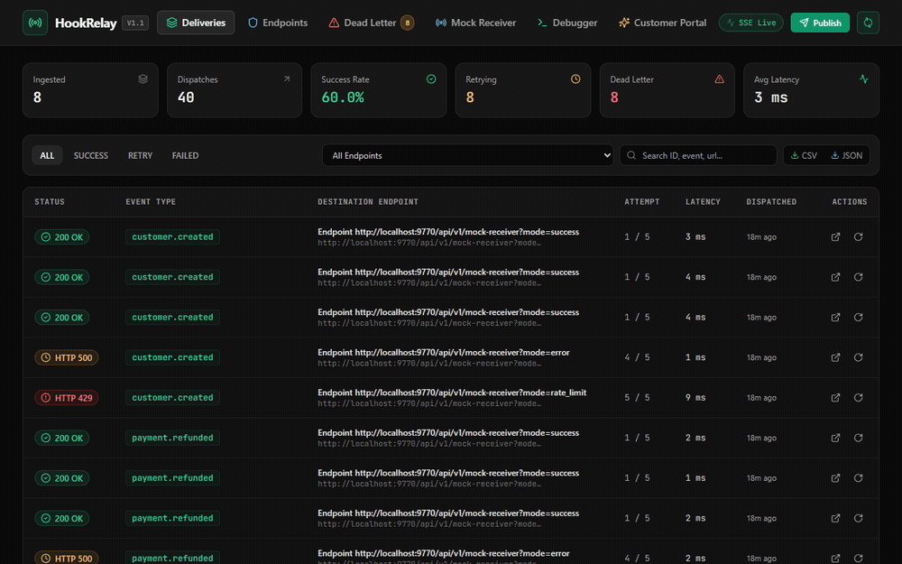
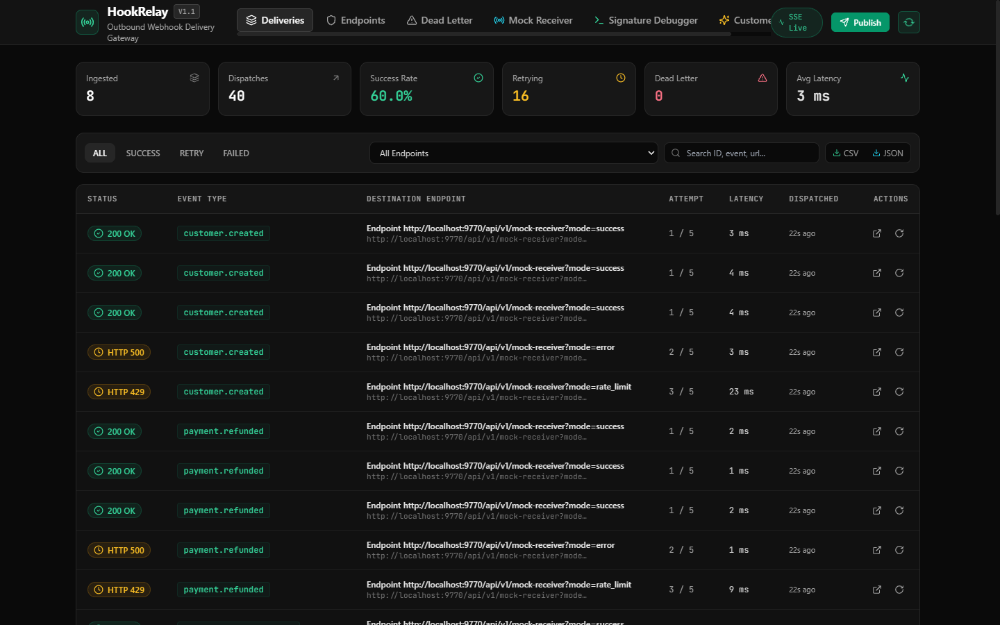
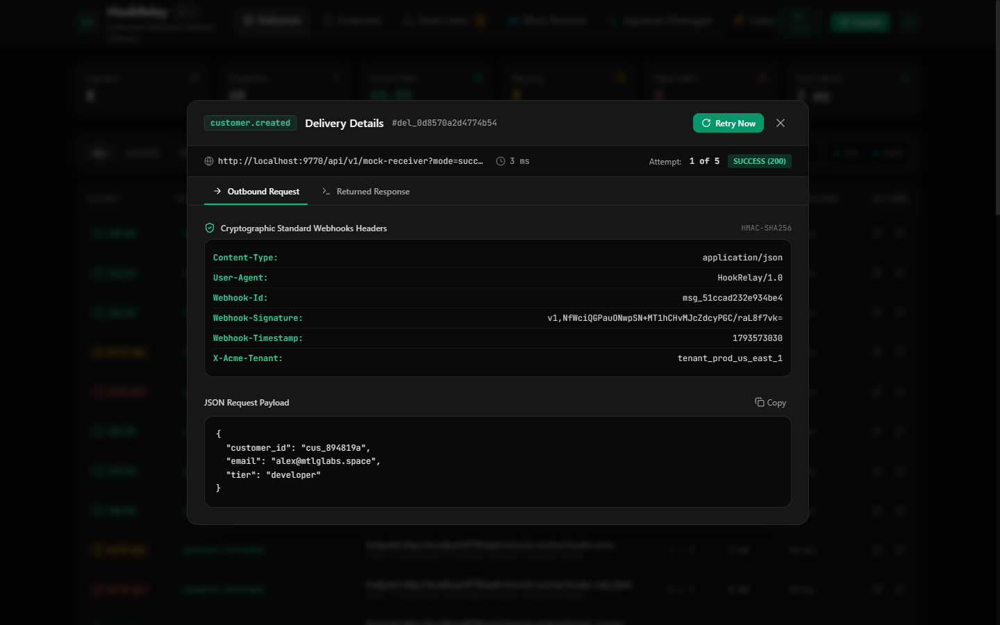
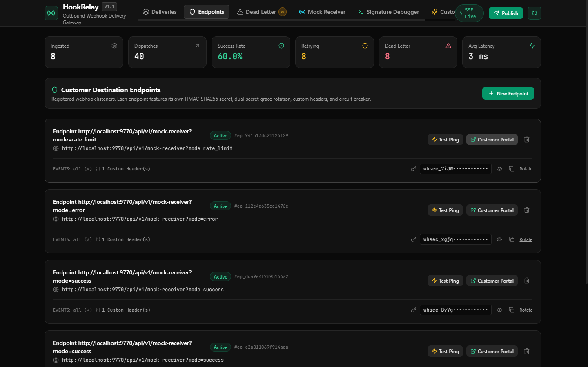
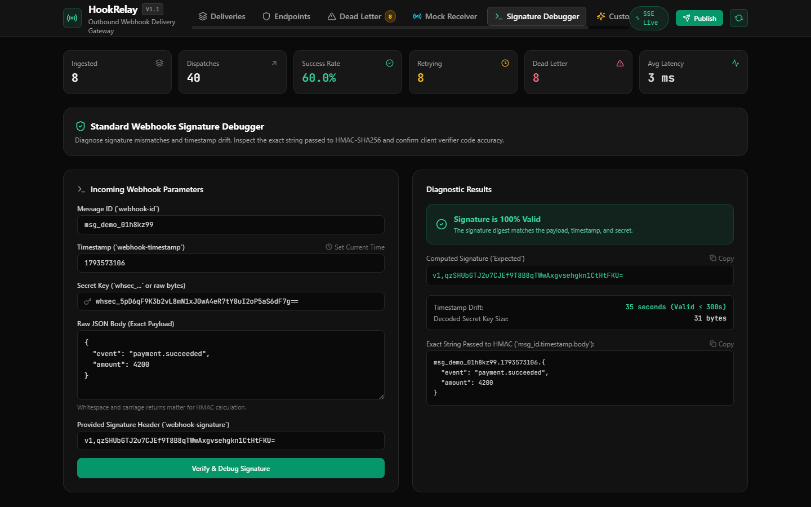
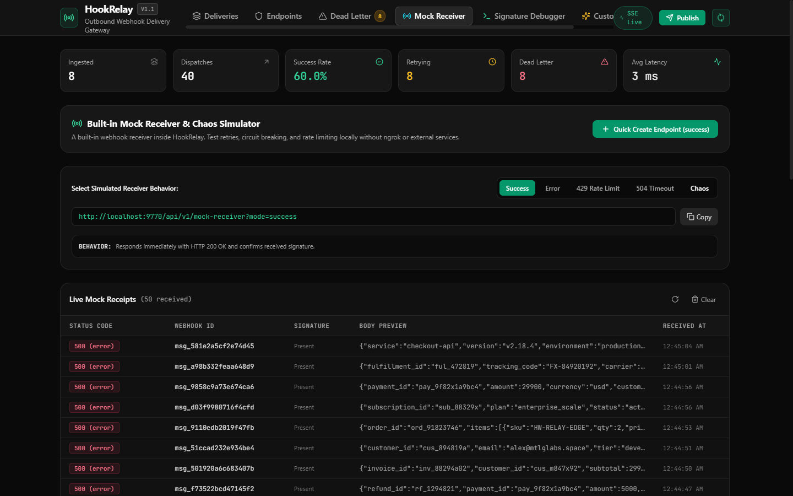
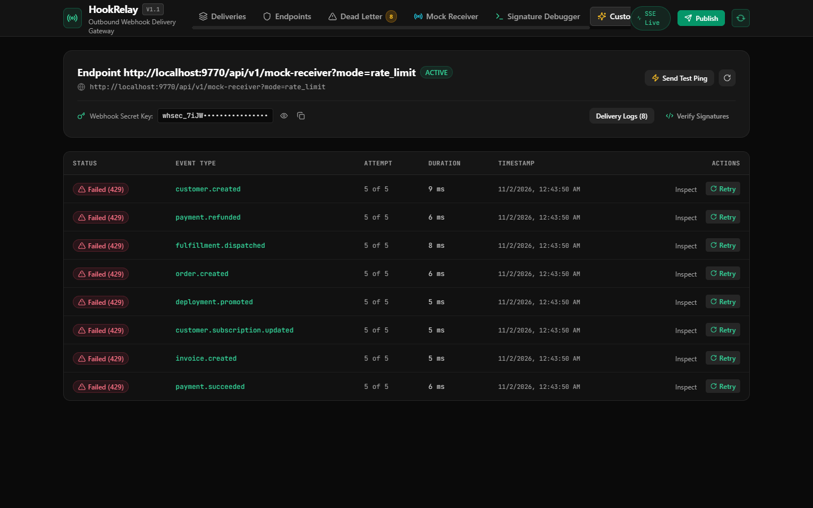
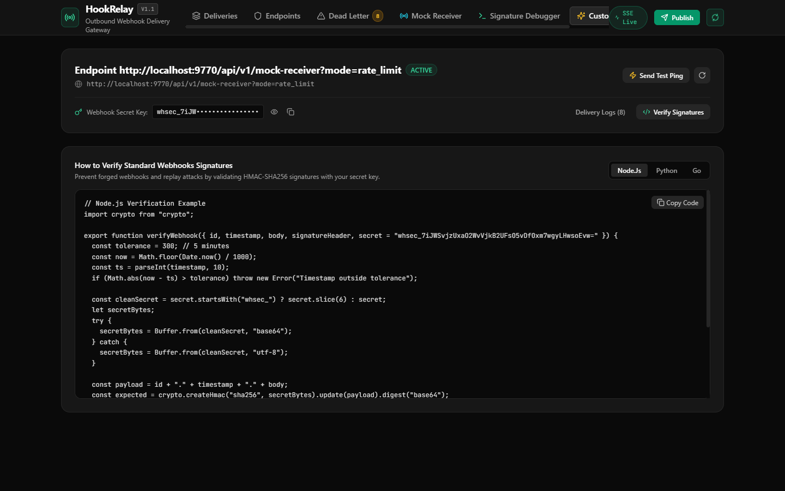
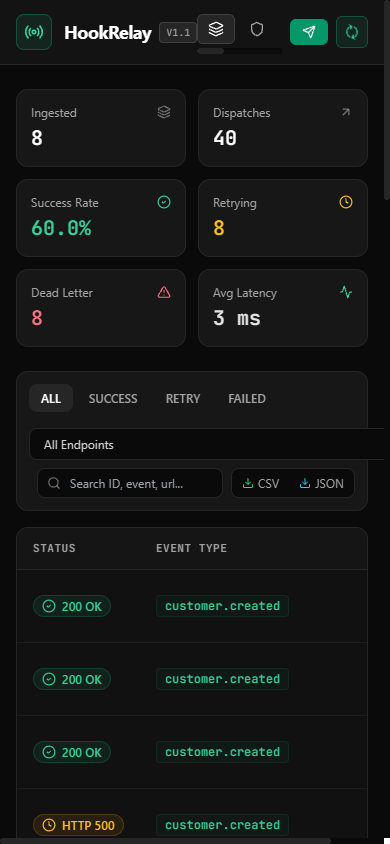

<p align="center">
  
</p>

<h1 align="center">HookRelay</h1>

<p align="center">
  
  
  
  
  
</p>

<p align="center">
  Self-hosted outbound webhook delivery engine with Standard Webhooks HMAC-SHA256 signing, exponential backoff retries, per-endpoint circuit breaking, and a customer self-serve delivery portal.
</p>

<p align="center">
  
</p>

HookRelay replaces commercial webhook delivery vendors like Svix or Hookdeck. Applications send internal HTTP calls to `POST /api/v1/publish`, and HookRelay manages signature generation, connection timeouts, exponential retries, and customer visibility.

---

## Live Web Studio & Interface

The embedded React 19 web studio connects to the Go daemon over Server-Sent Events (SSE) with sub-10ms telemetry updates.

### 1. Delivery Stream & Operational Telemetry
Live inspection of outbound webhook deliveries across all customer endpoints with status filters, latency metrics, and real-time SSE updates.

<p align="center">
  
</p>

### 2. Cryptographic Payload & Header Inspection
Side-by-side inspection of outbound request headers (`webhook-id`, `webhook-timestamp`, `webhook-signature`), custom headers, JSON payload, and receiver responses.

<p align="center">
  
</p>

### 3. Customer Destination Endpoints & Secret Rotation
Register webhook listeners with custom rate limits and headers. Rotate secrets with an automated 24-hour dual-secret grace period (`v1,<new> v1,<old>`) to prevent delivery failures during client updates.

<p align="center">
  
</p>

### 4. Interactive Signature Debugger
In-browser diagnostic tool to test and debug cryptographic HMAC-SHA256 signatures, timestamp drift tolerance, and canonical string representation.

<p align="center">
  
</p>

### 5. Built-in Mock Receiver & Chaos Simulator
Test webhooks locally without ngrok. The mock receiver supports HTTP 200 OK, HTTP 500 error, HTTP 429 rate limit with `Retry-After`, HTTP 504 timeout, and random chaos modes with a live receipt stream.

<p align="center">
  
</p>

### 6. Customer Self-Serve Delivery Portal & Verification Guides
Scoped URL tokens grant end customers access to their own delivery logs, allowing them to verify deliveries, trigger manual retries, and copy language-specific HMAC verification snippets (Node.js, Python, Go).

<p align="center">
  
</p>

<p align="center">
  
</p>

### 7. Mobile Viewport Support
Responsive design tested across standard desktop and mobile viewports (390x844).

<p align="center">
  
</p>

---

## Key Features

- **Fast Intake API**: Ingests events in under 2ms with optional `Idempotency-Key` deduplication.
- **Fan-Out & Targeted Delivery**: Publish directly to a specific endpoint or fan out to all subscribers matching an event type pattern.
- **Standard Webhooks Signatures**: Signs every outbound request with `webhook-id`, `webhook-timestamp`, and `webhook-signature` using HMAC-SHA256.
- **Dual Secret Rotation with 24h Grace Period**: Outbound requests carry both new and previous signatures during rotation (`v1,<new> v1,<old>`) to eliminate customer downtime.
- **Token Bucket Rate Limiting per Endpoint**: Paces outbound deliveries according to each customer endpoint's configured capacity.
- **Adaptive Retry-After Handling**: Respects HTTP 429 response headers and schedules the next attempt at the recipient's requested time.
- **Durable Exponential Retries**: 5-step schedule (5s, 1m, 15m, 1h, 24h) with randomized jitter (+/-15%) backed by SQLite in WAL mode.
- **Per-Endpoint Circuit Breakers**: Automatically pauses delivery after 50 consecutive failures to prevent downstream flooding and resource exhaustion.
- **Circuit Breaker Alert Webhooks**: Dispatches system alert webhooks to an ops URL whenever a customer endpoint trips.
- **SSRF Network Protection**: Blocks requests to loopback, private RFC 1918 subnets, and cloud instance metadata addresses. Rejects HTTP redirects by default.
- **Built-in Mock Receiver & Chaos Simulator**: Built-in endpoint (`/api/v1/mock-receiver`) with configurable behaviors (200 OK, 500 Error, 429 Rate Limit, 504 Timeout, Chaos mode) for instant local testing.
- **Interactive Signature Debugger**: In-browser diagnostic tool to test and debug cryptographic signatures and timestamp drift.
- **Server-Sent Events (SSE) Live Feed**: Sub-10ms delivery stream push to the web studio via `/api/v1/events/stream`.
- **Audit Log Export (CSV & JSON)**: One-click export of delivery history for compliance and dispute resolution.
- **Customer Self-Serve Portal**: Scoped URL tokens allow end customers to review their delivery status, view code examples for signature verification, and trigger manual retries.
- **Single-Binary Distribution**: Written in Go with pure Go SQLite (`modernc.org/sqlite`) and an embedded React 19 web studio. No external database or runtime required.

---

## Architecture

```
+-----------------------------------------------------------------------------------+
|                                     HOOKRELAY                                     |
+-----------------------------------------+-----------------------------------------+
                                          |
        +---------------------------------+---------------------------------+
        |                                                                   |
+-------v-------------------------+                 +-----------------------v-------+
|    Internal Ingestion API       |                 |    HMAC-SHA256 Signing Engine |
|  * POST /api/v1/publish         |                 |  * Standard Webhooks Spec     |
|  * Sub-2ms Non-Blocking Intake  |                 |  * Timestamp Replay Defense   |
|  * Topic & Tenant Routing       |                 |  * Dual Secret Grace Period   |
|  * Idempotency Key De-dupe      |                 |  * Multi-language Verifiers   |
+-------+-------------------------+                 +-----------------------+-------+
        |                                                                   |
        +---------------------------------+---------------------------------+
                                          |
                        +-----------------v-----------------+
                        |    Durable Retry State Machine    |
                        |  * Exponential Backoff & Jitter   |
                        |  * Schedule: 5s, 1m, 15m, 1h, 24h |
                        |  * Token Bucket Rate Limiting     |
                        |  * Circuit Breaker & Ops Alerts   |
                        |  * Dead Letter Queue (DLQ)        |
                        +-----------------+-----------------+
                                          |
                        +-----------------v-----------------+
                        |    High-Concurrency HTTP Worker   |
                        |  * Go Goroutine Worker Pool       |
                        |  * Strict 5s Connect/Read Timeout |
                        |  * Anti-SSRF Private IP Blocker   |
                        |  * Custom Headers per Endpoint    |
                        |  * Full Payload & Response Record |
                        +-----------------+-----------------+
                                          |
                        +-----------------v-----------------+
                        |   Interactive Web Studio & Portal |
                        |  * Real-Time SSE Stream (:9770)   |
                        |  * Customer Self-Serve Portal     |
                        |  * Built-in Mock Receiver & Chaos |
                        |  * Interactive Signature Debugger |
                        |  * CSV / JSON Audit Log Export    |
                        +-----------------------------------+
```

---

## Installation & Quick Start

### Build from Source

Requirements: Go 1.23+ and Node.js 20+ (for building the web UI).

```bash
# Clone the repository
git clone https://github.com/alexandrmotologa/hookrelay.git
cd hookrelay

# Build frontend and compile binary
npm --prefix web install
npm --prefix web run build
go build -o hookrelay.exe ./cmd/hookrelay

# Start the server
./hookrelay.exe serve --port 9770 --db ./hookrelay.db
```

The Web Studio opens at `http://localhost:9770`.

---

## Quick Usage

### 1. Register an Endpoint

```bash
curl -X POST http://localhost:9770/api/v1/endpoints \
  -H "Content-Type: application/json" \
  -d '{
    "name": "Acme Payments Webhook",
    "url": "https://api.example.com/webhooks",
    "event_types": ["payment.succeeded", "invoice.created"],
    "custom_headers": {
      "Authorization": "Bearer secret_api_token"
    },
    "rate_limit": 50
  }'
```

Returns:
```json
{
  "id": "ep_01jh823...",
  "name": "Acme Payments Webhook",
  "url": "https://api.example.com/webhooks",
  "secret": "whsec_x8F2...",
  "status": "ACTIVE"
}
```

### 2. Publish an Event

```bash
curl -X POST http://localhost:9770/api/v1/publish \
  -H "Content-Type: application/json" \
  -H "Idempotency-Key: evt_order_9981" \
  -d '{
    "event_type": "payment.succeeded",
    "payload": {
      "order_id": "ord_9981",
      "amount": 4900,
      "currency": "usd"
    }
  }'
```

HookRelay immediately schedules the delivery, signs the payload using HMAC-SHA256, and dispatches the request with the headers:
- `webhook-id`: Message ID
- `webhook-timestamp`: Unix timestamp in seconds
- `webhook-signature`: `v1,<signature>` (or dual signatures during secret rotation)

---

## Documentation

- [API Specification](docs/API_SPEC.md)
- [Standard Webhooks Cryptography & Verifier Guides](docs/STANDARD_WEBHOOKS.md)
- [System Architecture & Concurrency Model](docs/ARCHITECTURE.md)

---

## License

MIT License. Copyright (c) 2026 Alexandr Motologa.
